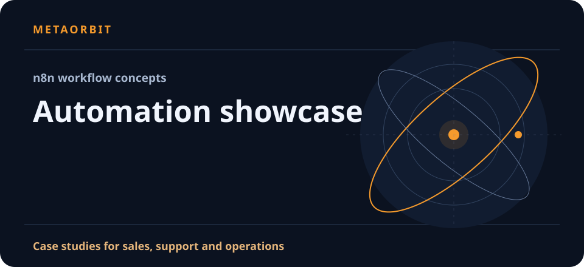
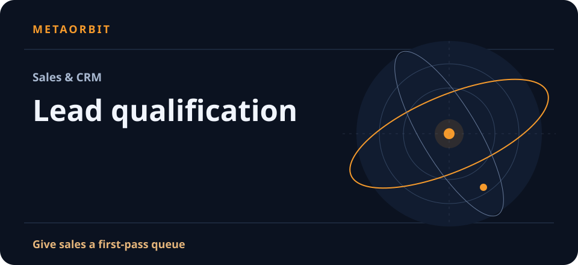
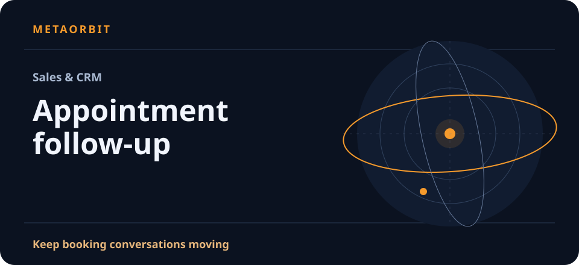
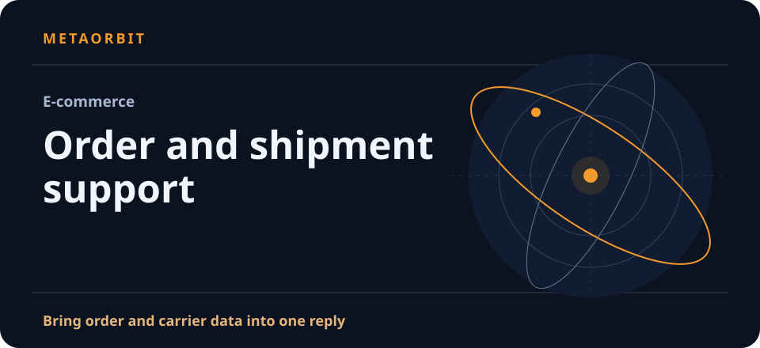
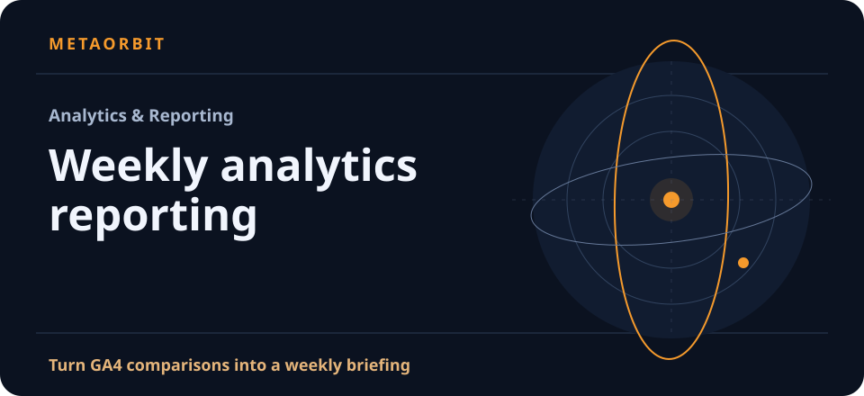
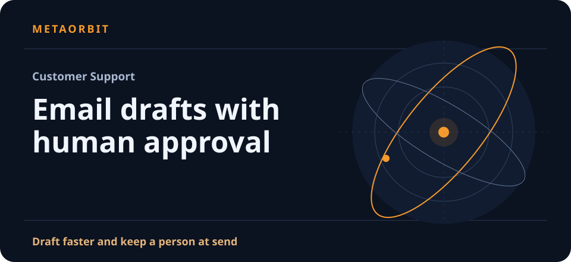

# MetaOrbit Automation Showcase

Ten visual case studies on how sales, support, and operations teams could use n8n. Each study starts with a business problem, follows the workflow architecture, and identifies what would need to be verified before use.

     

**Concept / Template Analysis** applies to all ten projects. The portfolio documents third-party workflow concepts through static review. Illustrations use fictional inputs and outcomes.

Each case study also includes a real n8n editor screenshot of its separate, inactive demonstration. The canvas shows the saved nodes and connections. Successful execution and live integrations remain unverified.

[Featured projects](#featured-projects) · [Sales & CRM](#sales--crm) · [Messaging](#messaging) · [E-commerce](#e-commerce) · [Customer Support](#customer-support) · [Analytics & Reporting](#analytics--reporting) · [Make.com](#makecom) · [Credits](CREDITS.md)

## Featured projects

| Project | Project |
| --- | --- |
|  **[Lead qualification](projects/lead-qualification.md)** Give sales a first-pass queue |  **[Appointment follow-up](projects/appointment-follow-up.md)** Keep booking conversations moving |
|  **[Order and shipment support](projects/order-support.md)** Bring order and carrier data into one reply |  **[Weekly analytics reporting](projects/analytics-reporting.md)** Turn GA4 comparisons into a weekly briefing |
|  **[Email drafts with human approval](projects/email-human-approval.md)** Draft faster and keep a person at send |  |

## Browse all projects

### Sales & CRM

- [Lead qualification](projects/lead-qualification.md) — Give sales a first-pass queue.
- [Appointment follow-up](projects/appointment-follow-up.md) — Keep booking conversations moving.
- [Company research for sales](projects/company-research.md) — Give reps a starting point for account research.

### Messaging

- [WhatsApp assistant](projects/whatsapp-assistant.md) — Reply to chats and stage a knowledge store.
- [Instagram DM assistant](projects/instagram-dm.md) — Answer recurring direct messages.

### E-commerce

- [Order and shipment support](projects/order-support.md) — Bring order and carrier data into one reply.
- [Personal shopper](projects/personal-shopper.md) — Turn shopping intent into a catalog query.

### Customer Support

- [Support ticket triage](projects/support-triage.md) — Surface aging tickets and route the next step.
- [Email drafts with human approval](projects/email-human-approval.md) — Draft faster and keep a person at send.

### Analytics & Reporting

- [Weekly analytics reporting](projects/analytics-reporting.md) — Turn GA4 comparisons into a weekly briefing.

## Make.com

**Coming Soon.** The showcase will add Make.com case studies when verified scenarios are available.
