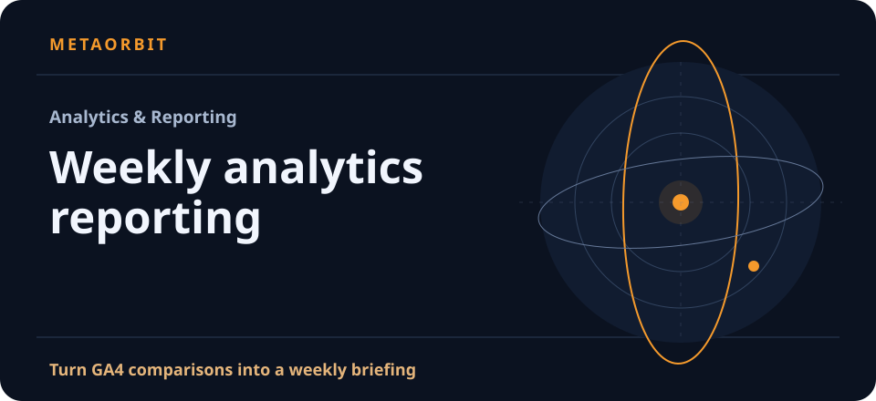
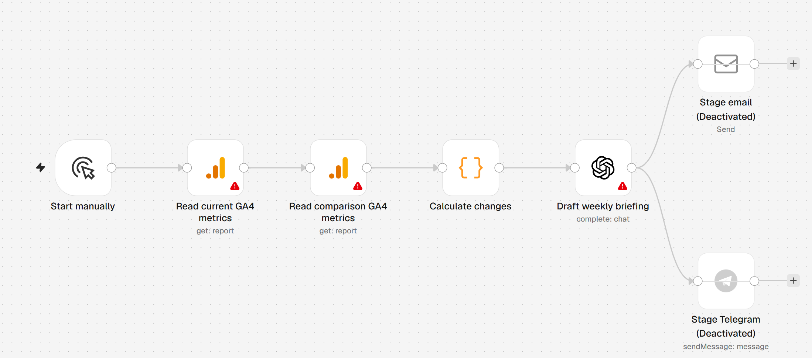

[Portfolio](../README.md) · [Analytics & Reporting](../README.md#analytics--reporting)

# Weekly analytics reporting

**Concept / Template Analysis**

**Local demo status:** Independently adapted in n8n, inactive, and unexecuted. Credentials and live destinations are unconnected.

## Business problem

A team collects similar analytics figures every week, but stakeholders want a short explanation of what changed.

## Why the problem matters

Manual reporting takes time, and inconsistent comparison periods can make the narrative misleading.

## Proposed automation solution

Pull current-period GA4 data, summarize it, calculate a prior-year window, then summarize that data too. OpenAI drafts the comparison for HTML email, and a connected branch reformats the report for Telegram.

## Workflow architecture

*Captured directly from a local n8n editor. It shows 7 nodes and 6 connections. Names ending in `.invalid` are placeholders. Warning and disabled states are visible in the capture.*

### What the demo illustrates

Every Monday, an operations manager exports the same metrics. The numbers are easy to copy; choosing a fair comparison and explaining the change takes longer.

The screenshot shows separate current and comparison GA4 nodes, a calculation slot, an OpenAI draft, and two disabled delivery steps. A draft states a 20% rise and names both periods. A reviewer reconciles values against GA4.

Configure both GA4 periods, preserve both reports through the handoff, and implement and reconcile the calculation against GA4. The email and Telegram nodes are disabled.

Measure preparation time and discrepancies between the briefing and source reports.

The [template diagram](../assets/analytics-reporting-architecture.svg) summarizes the reviewed source concept. The screenshot shows the separate adaptation. Source authorship and redistribution rights remain unverified. The original export, prompts, account references, and template artwork are excluded.

The diagram groups related steps from the reviewed export. See the [text equivalent](#architecture-text-equivalent) for the same paths.

## Integrations

- GA4
- OpenAI
- SMTP
- Telegram

## Illustrative input and output

- **Fictional input** — Fictional current and prior periods have 1,200 and 1,000 sessions respectively.
- **Illustrative output** — The briefing reports a 20% increase in sessions and identifies the two comparison periods.

## Expected business value

A consistent briefing could reduce reporting effort. Measure time to prepare and the rate of mismatches with GA4.

## Current testing status

The portfolio review was static. The example above illustrates the intended behavior. Validate weighting, date windows, and zero denominators against GA4. Email and Telegram are both connected outputs.

## Architecture text equivalent

- Weekly schedule → Current GA4 → summarize
- Current GA4 → summarize → Build prior-year window
- Build prior-year window → Prior GA4 → summarize
- Prior GA4 → summarize → Draft comparison
- Draft comparison → Send HTML email
- Draft comparison → Reformat → Telegram

[Back to portfolio](../README.md) · [Credits and review scope](../CREDITS.md)
