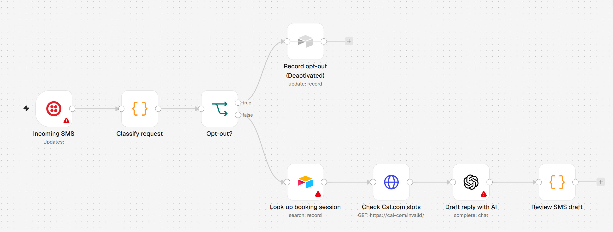

[Portfolio](../README.md) · [Sales & CRM](../README.md#sales--crm)

# Appointment follow-up

**Concept / Template Analysis**

**Local demo status:** Independently adapted in n8n, inactive, and unexecuted. Credentials and live destinations are unconnected.

## Business problem

A service coordinator handles booking questions and has to remember which enquiries still need a follow-up.

## Why the problem matters

A missed reminder can stall a valid enquiry. A reminder after an opt-out can damage trust.

## Proposed automation solution

Use an inbound SMS branch for command detection, session lookup, and booking actions. A separate daily branch finds eligible contacts, drafts follow-ups, updates tracking fields, and sends SMS. The opt-out branch records STOP and sends confirmation.

## Workflow architecture

*Captured directly from a local n8n editor. It shows 8 nodes and 7 connections. Names ending in `.invalid` are placeholders. Warning and disabled states are visible in the capture.*

### What the demo illustrates

A repair shop closes at six. Three texts arrive at 6:05: a booking question, a reschedule, and one person asking to stop messages.

The screenshot shows inbound Twilio SMS, an opt-out decision, and a separate booking path with Airtable, a Cal.com availability slot, an OpenAI draft, and a human review step. A coordinator receives a proposed reply with available slots. An opt-out is routed separately and bypasses drafting.

Connect only sandbox Twilio and Airtable accounts. Configure the opt-out record mapping and booking-session lookup. The Cal.com request is a reserved placeholder. The graph has no automatic SMS send.

Measure time to reply, booking completion, and any messages sent after an opt-out.

The [template diagram](../assets/appointment-follow-up-architecture.svg) summarizes the reviewed source concept. The screenshot shows the separate adaptation. Source authorship and redistribution rights remain unverified. The original export, prompts, account references, and template artwork are excluded.

The diagram groups related steps from the reviewed export. Dashed arrows show tool or AI resource attachments. See the [text equivalent](#architecture-text-equivalent) for the same paths.

## Integrations

- Twilio
- Airtable
- OpenAI
- Cal.com

## Illustrative input and output

- **Fictional input** — A fictional prospect asks for a Thursday slot and later sends `STOP`.
- **Illustrative output** — The booking path offers availability. The STOP path is intended to record opt-out and confirm it.

## Expected business value

A shared session history could reduce coordination time and missed follow-ups. Track booking completion, opt-out handling, and message delivery.

## Current testing status

The portfolio review was static. The example above illustrates the intended behavior. Agent references use an outdated node name; the session write uses update rather than upsert. STOP detection and counters updated before delivery need testing.

## Architecture text equivalent

- Inbound SMS → Check commands
- Check commands → Load session → booking agent
- Load session → booking agent → Save session → SMS reply
- Check commands → Record STOP → confirm
- Daily schedule → Find leads → draft follow-up
- Find leads → draft follow-up → Update count → send SMS
- Cal.com booking tools attaches to Load session → booking agent

[Back to portfolio](../README.md) · [Credits and review scope](../CREDITS.md)
