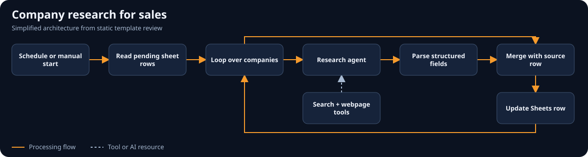

[Portfolio](../README.md) · [Sales & CRM](../README.md#sales--crm)

# Company research for sales

**Concept / Template Analysis**

## Business problem

A sales rep starts with a list of company names and repeatedly looks up the same basic product and market information.

## Why the problem matters

Manual research consumes prospecting time. Inconsistent sourcing can put inaccurate details into outreach.

## Proposed automation solution

Read pending sheet rows, process each through a company researcher with web search and page-reading tools, parse the output, and merge it back into the matching sheet row.

## Workflow architecture

The diagram groups related steps from the reviewed export. Dashed arrows show tool or AI resource attachments. See the [text equivalent](#architecture-text-equivalent) for the same paths.

## Integrations

- Google Sheets
- SerpAPI
- OpenAI
- HTTP

## Illustrative input and output

- **Fictional input** — A fictional company row has a name and no market classification.
- **Illustrative output** — A proposed output contains a domain and supported company attributes, leaving unknown details blank for review.

## Expected business value

A first-pass research queue could reduce repetitive lookups. Measure reviewer correction rates, source quality, and row-update accuracy.

## Current testing status

The portfolio review was static. The example above illustrates the intended behavior. The market prompt repeats one option, the parsed API-availability field is not saved, and an alternative scraping tool is disconnected.

## Architecture text equivalent

- Schedule or manual start → Read pending sheet rows
- Read pending sheet rows → Loop over companies
- Loop over companies → Research agent
- Research agent → Parse structured fields
- Parse structured fields → Merge with source row
- Loop over companies → Merge with source row
- Merge with source row → Update Sheets row
- Update Sheets row → Loop over companies
- Search + webpage tools attaches to Research agent

[Back to portfolio](../README.md) · [Credits and review scope](../CREDITS.md)
