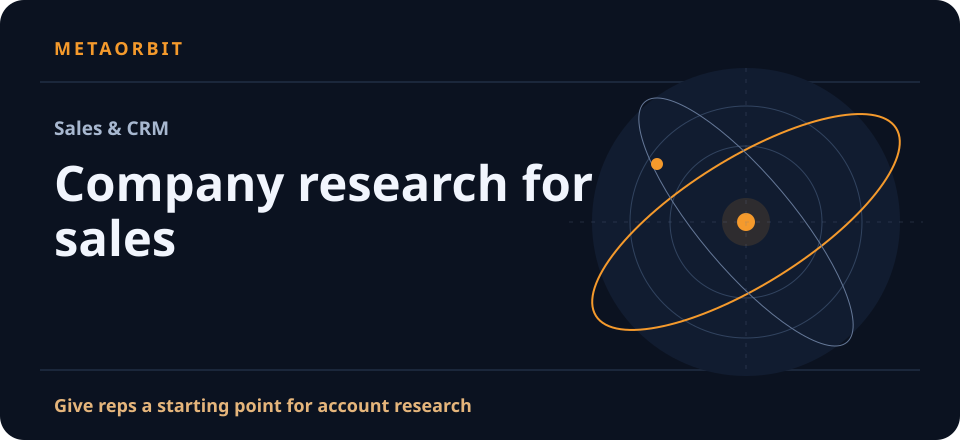
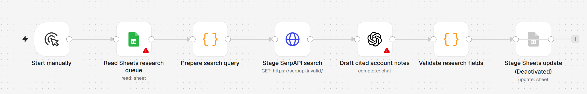

[Portfolio](../README.md) · [Sales & CRM](../README.md#sales--crm)

# Company research for sales

**Concept / Template Analysis**

**Local demo status:** Independently adapted in n8n, inactive, and unexecuted. Credentials and live destinations are unconnected.

## Business problem

A sales rep starts with a list of company names and repeatedly looks up the same basic product and market information.

## Why the problem matters

Manual research consumes prospecting time. Inconsistent sourcing can put inaccurate details into outreach.

## Proposed automation solution

Read pending sheet rows, process each through a company researcher with web search and page-reading tools, parse the output, and merge it back into the matching sheet row.

## Workflow architecture

*Captured directly from a local n8n editor. It shows 7 nodes and 6 connections. Names ending in `.invalid` are placeholders. Warning and disabled states are visible in the capture.*

### What the demo illustrates

A sales rep starts with a list of company names and spends the first hour of each day opening the same kinds of search tabs.

The screenshot shows a Sheets research queue, query preparation, a SerpAPI request slot, an OpenAI draft, and a disabled Sheets update. A draft flags unverified fields and presents a source URL for the reviewer to check.

Configure a sandbox sheet, a permitted search endpoint, source validation, and a stable row mapping. The SerpAPI request is a reserved placeholder and the Sheets update node is disabled.

Measure research time, unsupported claims and incorrect spreadsheet row updates.

The [template diagram](../assets/company-research-architecture.svg) summarizes the reviewed source concept. The screenshot shows the separate adaptation. Source authorship and redistribution rights remain unverified. The original export, prompts, account references, and template artwork are excluded.

The diagram groups related steps from the reviewed export. Dashed arrows show tool or AI resource attachments. See the [text equivalent](#architecture-text-equivalent) for the same paths.

## Integrations

- Google Sheets
- SerpAPI
- OpenAI
- HTTP

## Illustrative input and output

- **Fictional input** — A fictional company row has a name and no market classification.
- **Illustrative output** — A proposed output contains a domain and supported company attributes, leaving unknown details blank for review.

## Expected business value

A first-pass research queue could reduce repetitive lookups. Measure reviewer correction rates, source quality, and row-update accuracy.

## Current testing status

The portfolio review was static. The example above illustrates the intended behavior. The market prompt repeats one option, the parsed API-availability field is not saved, and an alternative scraping tool is disconnected.

## Architecture text equivalent

- Schedule or manual start → Read pending sheet rows
- Read pending sheet rows → Loop over companies
- Loop over companies → Research agent
- Research agent → Parse structured fields
- Parse structured fields → Merge with source row
- Loop over companies → Merge with source row
- Merge with source row → Update Sheets row
- Update Sheets row → Loop over companies
- Search + webpage tools attaches to Research agent

[Back to portfolio](../README.md) · [Credits and review scope](../CREDITS.md)
