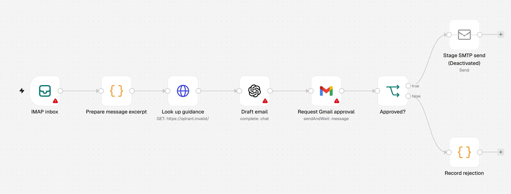

[Portfolio](../README.md) · [Customer Support](../README.md#customer-support)

# Email drafts with human approval

**Concept / Template Analysis**

**Local demo status:** Independently adapted in n8n, inactive, and unexecuted. Credentials and live destinations are unconnected.

## Business problem

A shared inbox receives repetitive enquiries that still need someone to review tone, facts, and commitments.

## Why the problem matters

Fully manual replies take time. Sending unchecked drafts can create incorrect promises or expose unrelated information.

## Proposed automation solution

Convert inbound email to Markdown, summarize it, and draft a response using a knowledge retrieval tool. Gmail requests approval. The approved branch sends via SMTP, while rejection loops back to drafting.

## Workflow architecture

*Captured directly from a local n8n editor. It shows 8 nodes and 7 connections. Names ending in `.invalid` are placeholders. Warning and disabled states are visible in the capture.*

### What the demo illustrates

A shared inbox gets a booking-change request. The reply is easy to draft, but the dates and commitments still need a person’s review.

The screenshot shows IMAP intake, a knowledge-lookup slot, an OpenAI email draft, a Gmail approval gate, and separate approval and rejection branches. The reviewer rejects the draft. The rejected branch stops at a review record instead of reaching SMTP.

Map the approval response into the decision step and use test inboxes. Qdrant is a reserved placeholder and SMTP is disabled. Rejection reaches a separate review record.

Measure review time, correction rate and any send without approval.

The [template diagram](../assets/email-human-approval-architecture.svg) summarizes the reviewed source concept. The screenshot shows the separate adaptation. Source authorship and redistribution rights remain unverified. The original export, prompts, account references, and template artwork are excluded.

The diagram groups related steps from the reviewed export. Dashed arrows show tool or AI resource attachments. See the [text equivalent](#architecture-text-equivalent) for the same paths.

## Integrations

- IMAP
- Gmail
- SMTP
- OpenAI
- DeepSeek
- Qdrant

## Illustrative input and output

- **Fictional input** — A fictional sender asks about a booking change, and a reviewer spots an incorrect date in the draft.
- **Illustrative output** — The reviewer rejects the draft and the flow returns to drafting. SMTP is reached only on the approval branch in the exported graph.

## Expected business value

Drafting assistance could save reviewer time while preserving the send decision. Measure review effort, rejected drafts, and any send without approval.

## Current testing status

The portfolio review was static. The example above illustrates the intended behavior. Verify the summary input mapping, the enabled parser with no attachment, and rejection-loop behavior. Test SMTP only with controlled addresses.

## Architecture text equivalent

- IMAP email → Markdown → summary
- Markdown → summary → Prepare draft inputs
- Prepare draft inputs → Knowledge-assisted draft
- Knowledge-assisted draft → Gmail approval request
- Gmail approval request → Approved?
- Approved? → Send via SMTP
- Approved? → Prepare draft inputs
- Qdrant retrieval attaches to Knowledge-assisted draft

[Back to portfolio](../README.md) · [Credits and review scope](../CREDITS.md)
