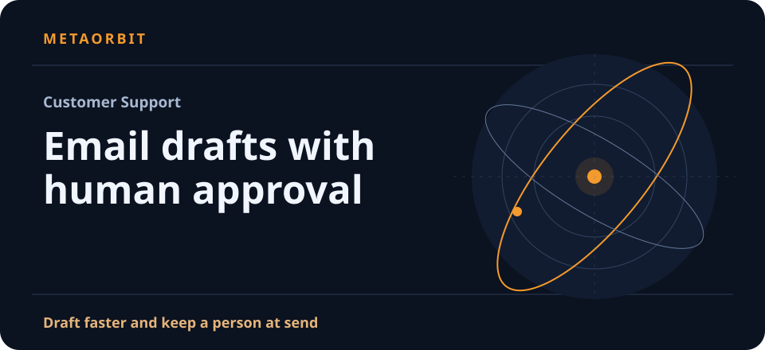
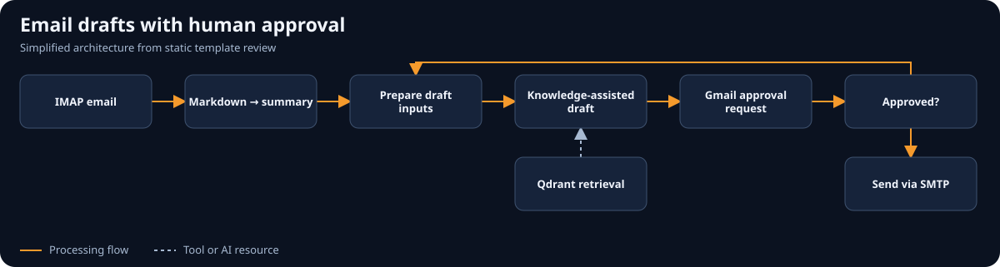

[Portfolio](../README.md) · [Customer Support](../README.md#customer-support)

# Email drafts with human approval

**Concept / Template Analysis**

## Business problem

A shared inbox receives repetitive enquiries that still need someone to review tone, facts, and commitments.

## Why the problem matters

Fully manual replies take time. Sending unchecked drafts can create incorrect promises or expose unrelated information.

## Proposed automation solution

Convert inbound email to Markdown, summarize it, and draft a response using a knowledge retrieval tool. Gmail requests approval. The approved branch sends via SMTP, while rejection loops back to drafting.

## Workflow architecture

The diagram groups related steps from the reviewed export. Dashed arrows show tool or AI resource attachments. See the [text equivalent](#architecture-text-equivalent) for the same paths.

## Integrations

- IMAP
- Gmail
- SMTP
- OpenAI
- DeepSeek
- Qdrant

## Illustrative input and output

- **Fictional input** — A fictional sender asks about a booking change, and a reviewer spots an incorrect date in the draft.
- **Illustrative output** — The reviewer rejects the draft and the flow returns to drafting. SMTP is reached only on the approval branch in the exported graph.

## Expected business value

Drafting assistance could save reviewer time while preserving the send decision. Measure review effort, rejected drafts, and any send without approval.

## Current testing status

The portfolio review was static. The example above illustrates the intended behavior. Verify the summary input mapping, the enabled parser with no attachment, and rejection-loop behavior. Test SMTP only with controlled addresses.

## Architecture text equivalent

- IMAP email → Markdown → summary
- Markdown → summary → Prepare draft inputs
- Prepare draft inputs → Knowledge-assisted draft
- Knowledge-assisted draft → Gmail approval request
- Gmail approval request → Approved?
- Approved? → Send via SMTP
- Approved? → Prepare draft inputs
- Qdrant retrieval attaches to Knowledge-assisted draft

[Back to portfolio](../README.md) · [Credits and review scope](../CREDITS.md)
