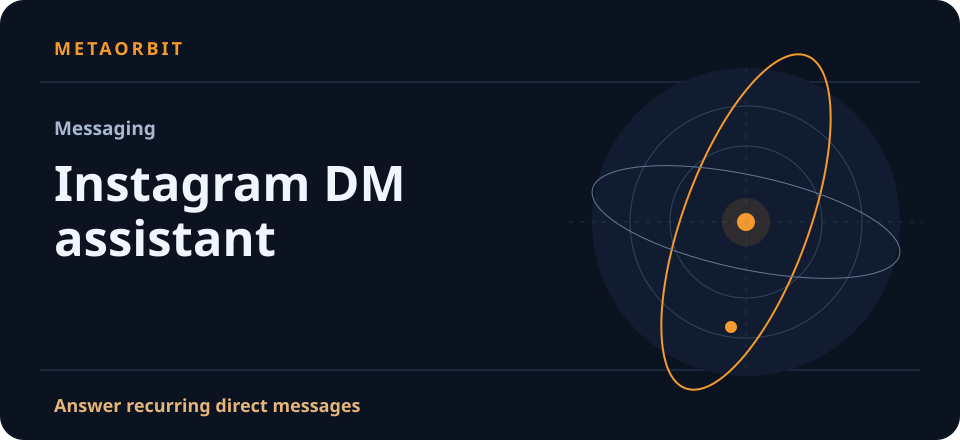
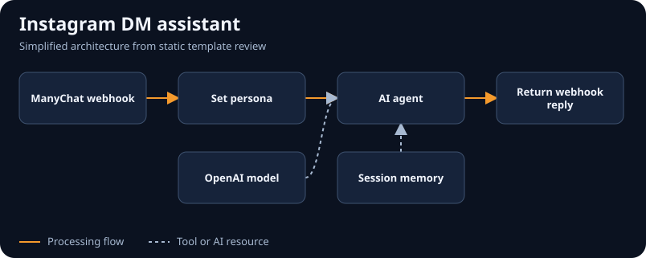

[Portfolio](../README.md) · [Messaging](../README.md#messaging)

# Instagram DM assistant

**Concept / Template Analysis**

## Business problem

A brand gets repetitive questions in Instagram DMs while staff handle other customer work.

## Why the problem matters

A slow first response can leave simple requests unanswered. Session mix-ups can leak context between conversations.

## Proposed automation solution

ManyChat posts incoming text and a session key to n8n. The workflow sets a persona, drafts a reply with session memory, and returns text through the webhook for ManyChat to use.

## Workflow architecture

The diagram groups related steps from the reviewed export. Dashed arrows show tool or AI resource attachments. See the [text equivalent](#architecture-text-equivalent) for the same paths.

## Integrations

- ManyChat
- Instagram
- OpenAI

## Illustrative input and output

- **Fictional input** — A fictional customer asks whether a pickup option exists.
- **Illustrative output** — ManyChat receives a proposed reply it can map into its outbound action.

## Expected business value

A consistent first response could keep common enquiries moving. Measure response time, accuracy, and memory isolation.

## Current testing status

The portfolio review was static. The example above illustrates the intended behavior. The export has no direct Instagram node or post-history ingestion. Verify the external reply mapping, session isolation, and timeout behavior.

## Architecture text equivalent

- ManyChat webhook → Set persona
- Set persona → AI agent
- AI agent → Return webhook reply
- OpenAI model attaches to AI agent
- Session memory attaches to AI agent

[Back to portfolio](../README.md) · [Credits and review scope](../CREDITS.md)
