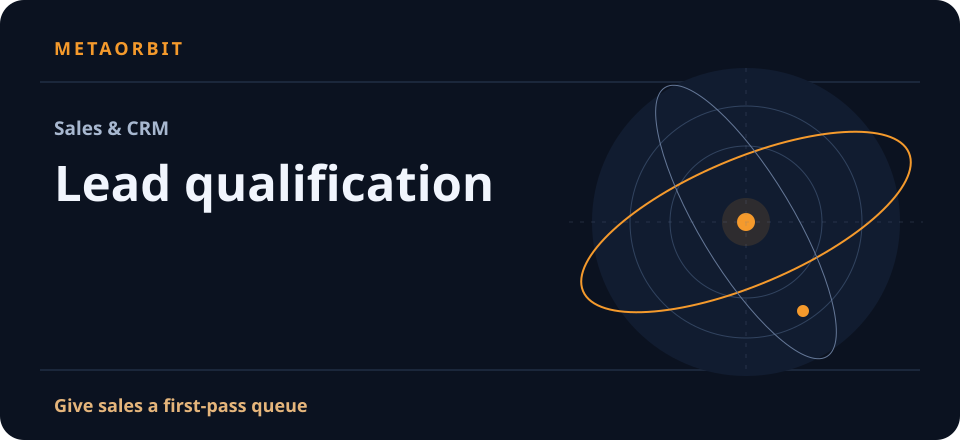
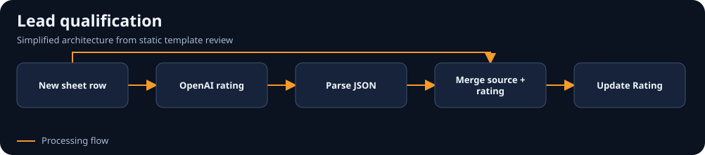

[Portfolio](../README.md) · [Sales & CRM](../README.md#sales--crm)

# Lead qualification

**Concept / Template Analysis**

## Business problem

A small sales team opens a spreadsheet full of new enquiries and has to decide whom to call first.

## Why the problem matters

Reps can spend their response window reading rows instead of following up. A changing rubric also makes equivalent enquiries hard to compare.

## Proposed automation solution

Apply an explicit rubric for decision-making responsibility, team size, and email-domain signals. The template parses the model’s JSON, merges the rating with the original row, then updates the sheet by timestamp. It writes the rating and leaves the reasoning out of the sheet.

## Workflow architecture

The diagram groups related steps from the reviewed export. See the [text equivalent](#architecture-text-equivalent) for the same paths.

## Integrations

- Google Sheets
- OpenAI

## Illustrative input and output

- **Fictional input** — A fictional founder manages a team of 12.
- **Illustrative output** — The corresponding row receives `qualified`; the rep still decides the follow-up.

## Expected business value

A shared rubric could reduce time to first review. Measure time to triage, reviewer agreement, and incorrect row updates.

## Current testing status

The portfolio review was static. The example above illustrates the intended behavior. Malformed JSON can stop the flow. Positional merging and timestamp matching need tests for dropped replies and duplicate timestamps.

## Architecture text equivalent

- New sheet row → OpenAI rating
- OpenAI rating → Parse JSON
- Parse JSON → Merge source + rating
- New sheet row → Merge source + rating
- Merge source + rating → Update Rating

[Back to portfolio](../README.md) · [Credits and review scope](../CREDITS.md)
