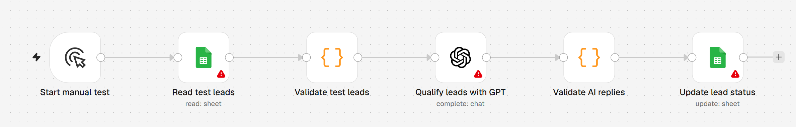

[Portfolio](../README.md) · [Sales & CRM](../README.md#sales--crm)

# Lead qualification

**Concept / Template Analysis**

**Local demo status:** The adapted n8n workflow retains the Google Sheets and OpenAI nodes. It is inactive, with test destinations and credentials unconnected.

## Business problem

Imagine a training company opening its inbox on Monday. One prospect wants twelve seats in two weeks. Another is asking about two seats next quarter. A third forgot to say how many people need training. All three enquiries deserve a reply, but the coordinator has to decide which conversation to start first.

## Why the problem matters

If every enquiry looks the same in the spreadsheet, the team has to reread each one before it can act. A shared rubric makes the order easier to explain and gives incomplete enquiries a place to go.

## Proposed automation solution

Apply an explicit rubric for decision-making responsibility, team size, and email-domain signals. The template parses the model’s JSON, merges the rating with the original row, then updates the sheet by timestamp. It writes the rating and leaves the reasoning out of the sheet.

## Workflow architecture

*Captured directly from the local n8n editor. The warning icons mark unconfigured nodes. The screenshot shows the saved layout and connections.*

The demo reads test rows on a manual trigger, rejects duplicate or invalid lead IDs, classifies the fictional inputs, and validates all replies before passing a rating to the Google Sheets update. It matches rows by lead ID. The [template diagram](../assets/lead-qualification-architecture.svg) and [text equivalent](#architecture-text-equivalent) describe the separate source concept.

## Integrations

- Google Sheets
- OpenAI

## Illustrative input and output

- **Fictional input** — A fictional founder manages a team of 12.
- **Illustrative output** — The corresponding row receives `qualified`; the rep still decides the follow-up.

## Expected business value

A shared rubric could reduce the time spent sorting enquiries. To evaluate it, compare time to first review, agreement between reviewers, and how often someone moves a lead to a different queue. A priority label should start a conversation and leave the follow-up decision with the coordinator.

## Current testing status

The template review was static. Malformed JSON can stop the flow. Positional merging and timestamp matching need tests for dropped replies and duplicate timestamps. The local demo is inactive and has not been executed. None of the examples are measured results.

## Local demo design

For a future controlled test, use a separate sheet with fictional enquiries. Include a duplicate lead ID and an invalid AI reply. Check that the workflow stops before writing either batch and that a valid reply changes only the intended rating cell.

The source concept is credited to [Yulia’s n8n listing](https://n8n.io/workflows/2163-qualify-new-leads-in-google-sheets-via-openais-gpt-4/). Redistribution rights remain unverified. This page shares the canvas of the local adaptation, with rewritten validation and fictional test inputs.

## Architecture text equivalent

- New sheet row → OpenAI rating
- OpenAI rating → Parse JSON
- Parse JSON → Merge source + rating
- New sheet row → Merge source + rating
- Merge source + rating → Update Rating

[Back to portfolio](../README.md) · [Credits and review scope](../CREDITS.md)
