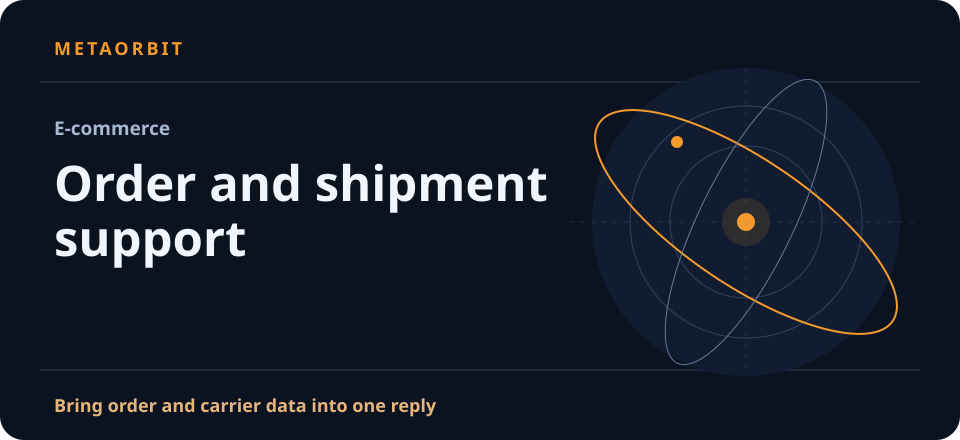
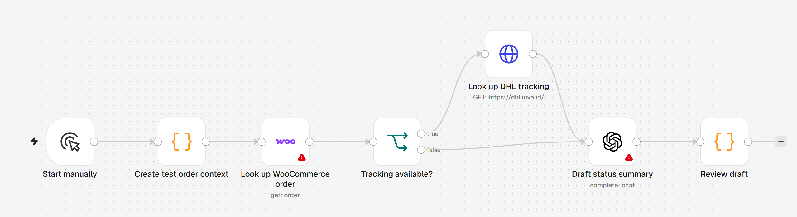

[Portfolio](../README.md) · [E-commerce](../README.md#e-commerce)

# Order and shipment support

**Concept / Template Analysis**

**Local demo status:** Independently adapted in n8n, inactive, and unexecuted. Credentials and live destinations are unconnected.

## Business problem

A shopper asks where an order is, and a support rep has to check both the store and the carrier.

## Why the problem matters

Context switching delays a straightforward answer. A mistaken identity can expose another customer's order.

## Proposed automation solution

A chat agent calls an order lookup tool. The tool resolves a customer, retrieves WooCommerce orders, checks for tracking, and enriches available shipments through DHL before returning combined data.

## Workflow architecture

*Captured directly from a local n8n editor. It shows 7 nodes and 7 connections. Names ending in `.invalid` are placeholders. Warning and disabled states are visible in the capture.*

### What the demo illustrates

A shopper asks where a parcel is. The support rep has to check the store order and the carrier while keeping another shopper’s order out of sight.

The screenshot shows a WooCommerce order lookup, a tracking decision with a DHL branch, and a review step for the drafted reply. The draft states that tracking is unavailable and tells the rep which field needs checking.

The tracking branch expects a mapped boolean. A sandbox identity and order-ownership check must be implemented before any real lookup, and the DHL destination is a reserved placeholder. The graph ends at review.

Measure lookup accuracy, handling time and incorrect disclosure in an authorized sandbox.

The [template diagram](../assets/order-support-architecture.svg) summarizes the reviewed source concept. The screenshot shows the separate adaptation. Source authorship and redistribution rights remain unverified. The original export, prompts, account references, and template artwork are excluded.

The diagram groups related steps from the reviewed export. Dashed arrows show tool or AI resource attachments. See the [text equivalent](#architecture-text-equivalent) for the same paths.

## Integrations

- WooCommerce
- DHL
- OpenAI

## Illustrative input and output

- **Fictional input** — A fictional shopper requests the status of a shipped order.
- **Illustrative output** — An illustrative reply can show order status and a carrier update when both sources return a match.

## Expected business value

A single lookup could shorten routine status handling. Measure lookup accuracy, handling time, and behavior when tracking is missing.

## Current testing status

The portfolio review was static. The example above illustrates the intended behavior. The chat path supplies mock identity, and the decryption node is disabled. Authentication, per-customer authorization, and carrier failures require review.

## Architecture text equivalent

- Chat trigger → Disabled decrypt step
- Disabled decrypt step → Mock identity → agent
- Order lookup tool attaches to Mock identity → agent
- Order lookup tool → Find customer → orders
- Find customer → orders → Tracking present?
- Tracking present? → DHL lookup
- DHL lookup → Merge → tool response
- Tracking present? → Merge → tool response
- Find customer → orders → Missing input or match

[Back to portfolio](../README.md) · [Credits and review scope](../CREDITS.md)
