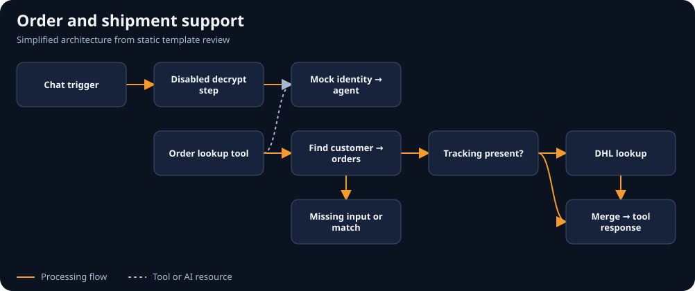

[Portfolio](../README.md) · [E-commerce](../README.md#e-commerce)

# Order and shipment support

**Concept / Template Analysis**

## Business problem

A shopper asks where an order is, and a support rep has to check both the store and the carrier.

## Why the problem matters

Context switching delays a straightforward answer. A mistaken identity can expose another customer's order.

## Proposed automation solution

A chat agent calls an order lookup tool. The tool resolves a customer, retrieves WooCommerce orders, checks for tracking, and enriches available shipments through DHL before returning combined data.

## Workflow architecture

The diagram groups related steps from the reviewed export. Dashed arrows show tool or AI resource attachments. See the [text equivalent](#architecture-text-equivalent) for the same paths.

## Integrations

- WooCommerce
- DHL
- OpenAI

## Illustrative input and output

- **Fictional input** — A fictional shopper requests the status of a shipped order.
- **Illustrative output** — An illustrative reply can show order status and a carrier update when both sources return a match.

## Expected business value

A single lookup could shorten routine status handling. Measure lookup accuracy, handling time, and behavior when tracking is missing.

## Current testing status

The portfolio review was static. The example above illustrates the intended behavior. The chat path supplies mock identity, and the decryption node is disabled. Authentication, per-customer authorization, and carrier failures require review.

## Architecture text equivalent

- Chat trigger → Disabled decrypt step
- Disabled decrypt step → Mock identity → agent
- Order lookup tool attaches to Mock identity → agent
- Order lookup tool → Find customer → orders
- Find customer → orders → Tracking present?
- Tracking present? → DHL lookup
- DHL lookup → Merge → tool response
- Tracking present? → Merge → tool response
- Find customer → orders → Missing input or match

[Back to portfolio](../README.md) · [Credits and review scope](../CREDITS.md)
