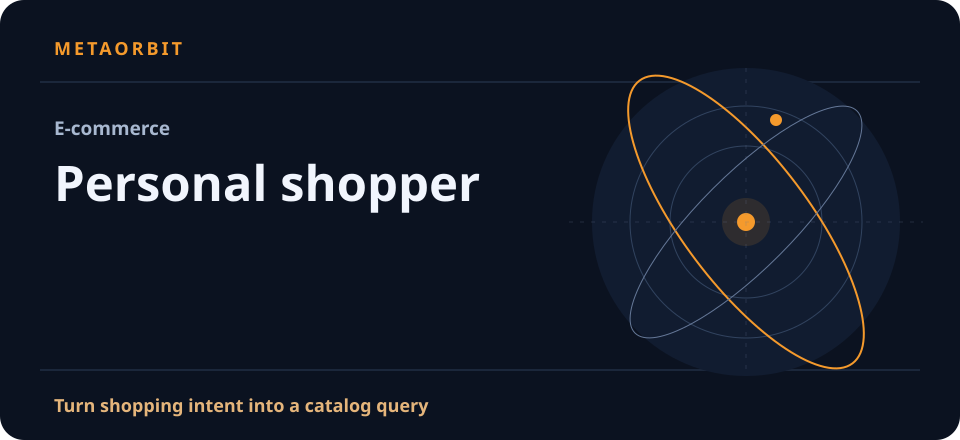
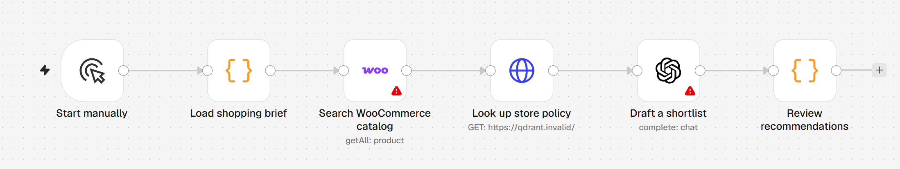

[Portfolio](../README.md) · [E-commerce](../README.md#e-commerce)

# Personal shopper

**Concept / Template Analysis**

**Local demo status:** Independently adapted in n8n, inactive, and unexecuted. Credentials and live destinations are unconnected.

## Business problem

A shopper knows their budget and use case but has trouble translating them into catalog filters.

## Why the problem matters

Relevant inventory stays hard to find when its descriptions use different words from the shopper.

## Proposed automation solution

Extract shopping intent and pass it to an agent with a WooCommerce search tool, calculator, and Qdrant-backed store information tool. A separate manual path refreshes documents from Drive.

## Workflow architecture

*Captured directly from a local n8n editor. It shows 6 nodes and 5 connections. Names ending in `.invalid` are placeholders. Warning and disabled states are visible in the capture.*

### What the demo illustrates

A customer wants a waterproof commuter bag under $70. The catalog uses different words, and the shopper has to open each listing to check stock.

The screenshot shows a fictional shopping brief followed by WooCommerce, a store-policy lookup, an OpenAI shortlist, and reviewer handoff. A proposed shortlist states the price and stock for returned matches or explains that no verified match is available.

Map the shopping brief into WooCommerce’s filters and combine catalog and policy results before drafting. The Qdrant request is a reserved placeholder. The graph has no checkout or messaging step.

Measure catalog match rate and how often a reviewer corrects price, stock, or policy claims.

The [template diagram](../assets/personal-shopper-architecture.svg) summarizes the reviewed source concept. The screenshot shows the separate adaptation. Source authorship and redistribution rights remain unverified. The original export, prompts, account references, and template artwork are excluded.

The diagram groups related steps from the reviewed export. Dashed arrows show tool or AI resource attachments. See the [text equivalent](#architecture-text-equivalent) for the same paths.

## Integrations

- WooCommerce
- OpenAI
- Google Drive
- Qdrant

## Illustrative input and output

- **Fictional input** — A fictional shopper asks for an in-stock commuter bag under $70.
- **Illustrative output** — A proposed reply lists suitable products and explains any trade-offs. Checkout is outside the connected workflow.

## Expected business value

Better catalog discovery could reduce time to a suitable product. Measure recommendation relevance, stock accuracy, and no-match behavior.

## Current testing status

The portfolio review was static. The example above illustrates the intended behavior. The extractor emits nested search parameters while the product tool expects flat inputs. The manual refresh clears existing collection contents before reloading.

## Architecture text equivalent

- Shopper chat → Normalize → extract intent
- Normalize → extract intent → Shopping agent
- WooCommerce search attaches to Shopping agent
- Store-information tool attaches to Shopping agent
- Manual refresh → Clear → Drive download
- Clear → Drive download → Embed → Qdrant insert

[Back to portfolio](../README.md) · [Credits and review scope](../CREDITS.md)
