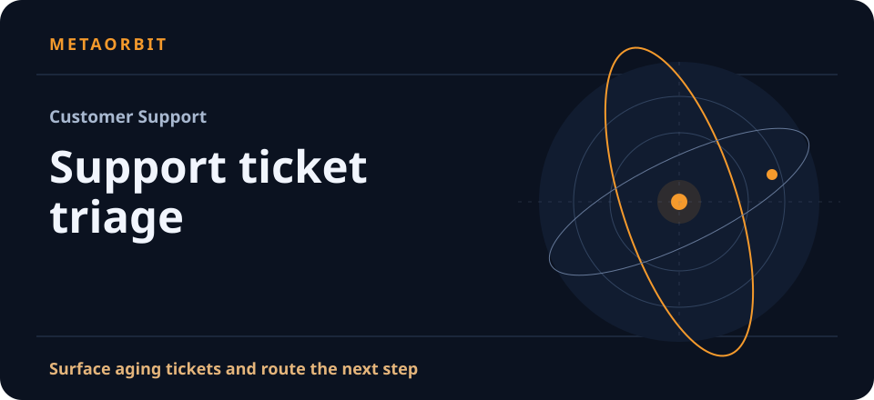
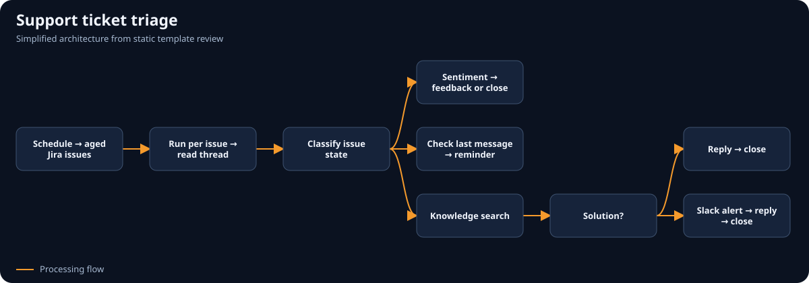

[Portfolio](../README.md) · [Customer Support](../README.md#customer-support)

# Support ticket triage

**Concept / Template Analysis**

## Business problem

A support lead has a queue of old tickets with different reasons for being open.

## Why the problem matters

A ticket waiting on the customer needs a different next step from a ticket nobody has answered. Bulk closure can hide unresolved work.

## Proposed automation solution

A scheduled search selects aging Jira issues. A per-issue path retrieves the thread and classifies its state, then branches into customer feedback, reminders, or a knowledge search. Some branches send Slack alerts and write or close Jira issues.

## Workflow architecture

The diagram groups related steps from the reviewed export. See the [text equivalent](#architecture-text-equivalent) for the same paths.

## Integrations

- Jira
- Notion
- Slack
- OpenAI

## Illustrative input and output

- **Fictional input** — A fictional issue has been open for eight days and its thread shows no verified fix.
- **Illustrative output** — The template can route it toward a knowledge search or a Slack alert. The no-solution branch currently still reaches closure.

## Expected business value

An explicit queue review could surface stalled work sooner. Measure classification agreement and unintended closures before any automatic Jira transitions.

## Current testing status

The portfolio review was static. The example above illustrates the intended behavior. The no-solution branch can close the issue. The negative-sentiment alert may reference an agent that did not run on that branch.

## Architecture text equivalent

- Schedule → aged Jira issues → Run per issue → read thread
- Run per issue → read thread → Classify issue state
- Classify issue state → Sentiment → feedback or close
- Classify issue state → Check last message → reminder
- Classify issue state → Knowledge search
- Knowledge search → Solution?
- Solution? → Reply → close
- Solution? → Slack alert → reply → close

[Back to portfolio](../README.md) · [Credits and review scope](../CREDITS.md)
