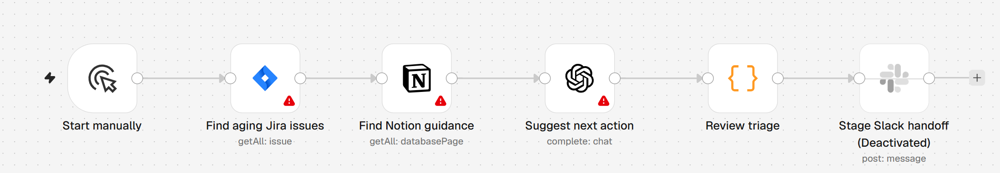

[Portfolio](../README.md) · [Customer Support](../README.md#customer-support)

# Support ticket triage

**Concept / Template Analysis**

**Local demo status:** Independently adapted in n8n, inactive, and unexecuted. Credentials and live destinations are unconnected.

## Business problem

A support lead has a queue of old tickets with different reasons for being open.

## Why the problem matters

A ticket waiting on the customer needs a different next step from a ticket nobody has answered. Bulk closure can hide unresolved work.

## Proposed automation solution

A scheduled search selects aging Jira issues. A per-issue path retrieves the thread and classifies its state, then branches into customer feedback, reminders, or a knowledge search. Some branches send Slack alerts and write or close Jira issues.

## Workflow architecture

*Captured directly from a local n8n editor. It shows 6 nodes and 5 connections. Names ending in `.invalid` are placeholders. Warning and disabled states are visible in the capture.*

### What the demo illustrates

A team lead opens an aging queue. One ticket is waiting for the customer, another has a likely workaround, and a third has no answer at all.

The screenshot shows the intended Jira and Notion lookup path, an OpenAI suggestion, and a disabled Slack handoff after review. The queue asks a reviewer to check the case and shows a proposed Slack handoff.

Set the Jira age window and map relevant issue and Notion context into the draft. The Slack node is disabled. The graph has no Jira mutation or closure node.

Measure reviewer agreement, time to unblock stale tickets and unintended state changes.

The [template diagram](../assets/support-triage-architecture.svg) summarizes the reviewed source concept. The screenshot shows the separate adaptation. Source authorship and redistribution rights remain unverified. The original export, prompts, account references, and template artwork are excluded.

The diagram groups related steps from the reviewed export. See the [text equivalent](#architecture-text-equivalent) for the same paths.

## Integrations

- Jira
- Notion
- Slack
- OpenAI

## Illustrative input and output

- **Fictional input** — A fictional issue has been open for eight days and its thread shows no verified fix.
- **Illustrative output** — The template can route it toward a knowledge search or a Slack alert. The no-solution branch currently still reaches closure.

## Expected business value

An explicit queue review could surface stalled work sooner. Measure classification agreement and unintended closures before any automatic Jira transitions.

## Current testing status

The portfolio review was static. The example above illustrates the intended behavior. The no-solution branch can close the issue. The negative-sentiment alert may reference an agent that did not run on that branch.

## Architecture text equivalent

- Schedule → aged Jira issues → Run per issue → read thread
- Run per issue → read thread → Classify issue state
- Classify issue state → Sentiment → feedback or close
- Classify issue state → Check last message → reminder
- Classify issue state → Knowledge search
- Knowledge search → Solution?
- Solution? → Reply → close
- Solution? → Slack alert → reply → close

[Back to portfolio](../README.md) · [Credits and review scope](../CREDITS.md)
