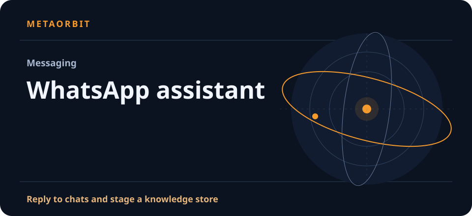
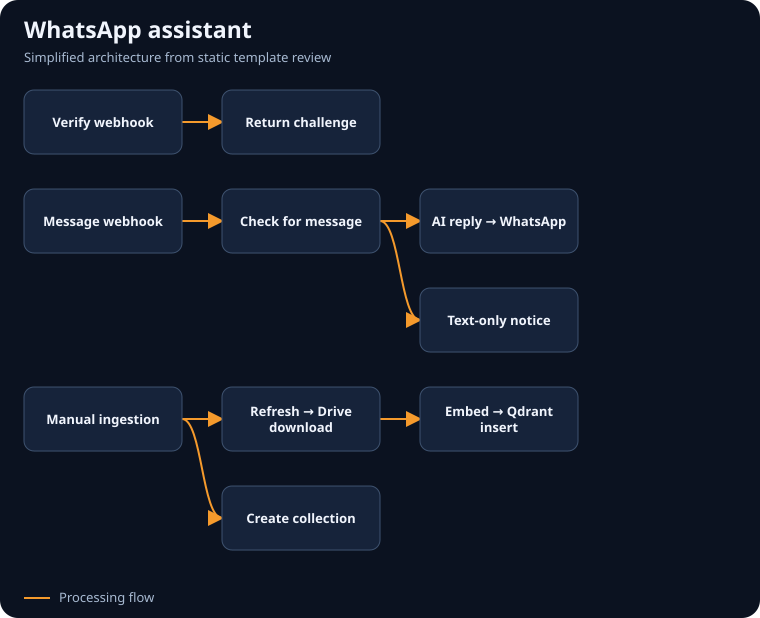

[Portfolio](../README.md) · [Messaging](../README.md#messaging)

# WhatsApp assistant

**Concept / Template Analysis**

## Business problem

A business receives the same basic questions through WhatsApp and keeps reference material in Drive.

## Why the problem matters

Staff repeat simple answers, and changes to support documentation can be hard to propagate consistently.

## Proposed automation solution

Route message events to an AI reply agent and send a text response. A separate manual ingestion path downloads Drive files, splits and embeds them, and writes to Qdrant. The export has no retrieval connection from Qdrant to the reply agent.

## Workflow architecture

The diagram groups related steps from the reviewed export. See the [text equivalent](#architecture-text-equivalent) for the same paths.

## Integrations

- WhatsApp Business
- OpenAI
- Google Drive
- Qdrant

## Illustrative input and output

- **Fictional input** — A fictional shopper asks about holiday operating hours.
- **Illustrative output** — The reply branch can return AI-generated text. The template does not retrieve the store’s holiday policy from the indexed files.

## Expected business value

The reply branch could assist with routine enquiries. Grounded answers would require a retrieval connection and a separate accuracy check.

## Current testing status

The portfolio review was static. The example above illustrates the intended behavior. Verify webhook authentication and status events. Collection refresh clears existing points, and the create and refresh branches can run in parallel.

## Architecture text equivalent

- Verify webhook → Return challenge
- Message webhook → Check for message
- Check for message → AI reply → WhatsApp
- Check for message → Text-only notice
- Manual ingestion → Refresh → Drive download
- Refresh → Drive download → Embed → Qdrant insert
- Manual ingestion → Create collection

[Back to portfolio](../README.md) · [Credits and review scope](../CREDITS.md)
